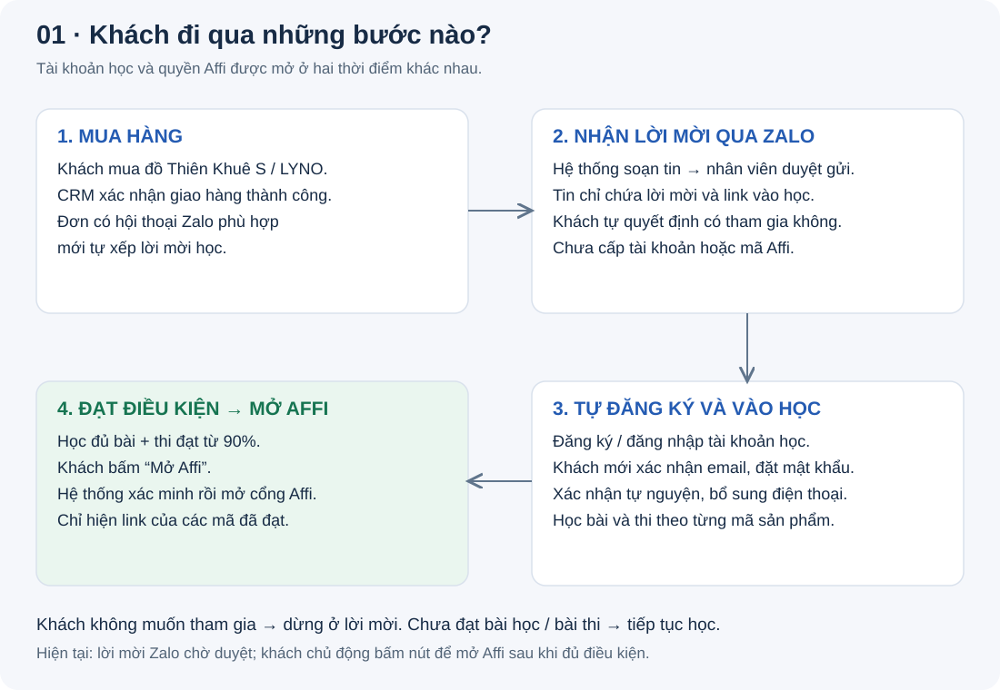
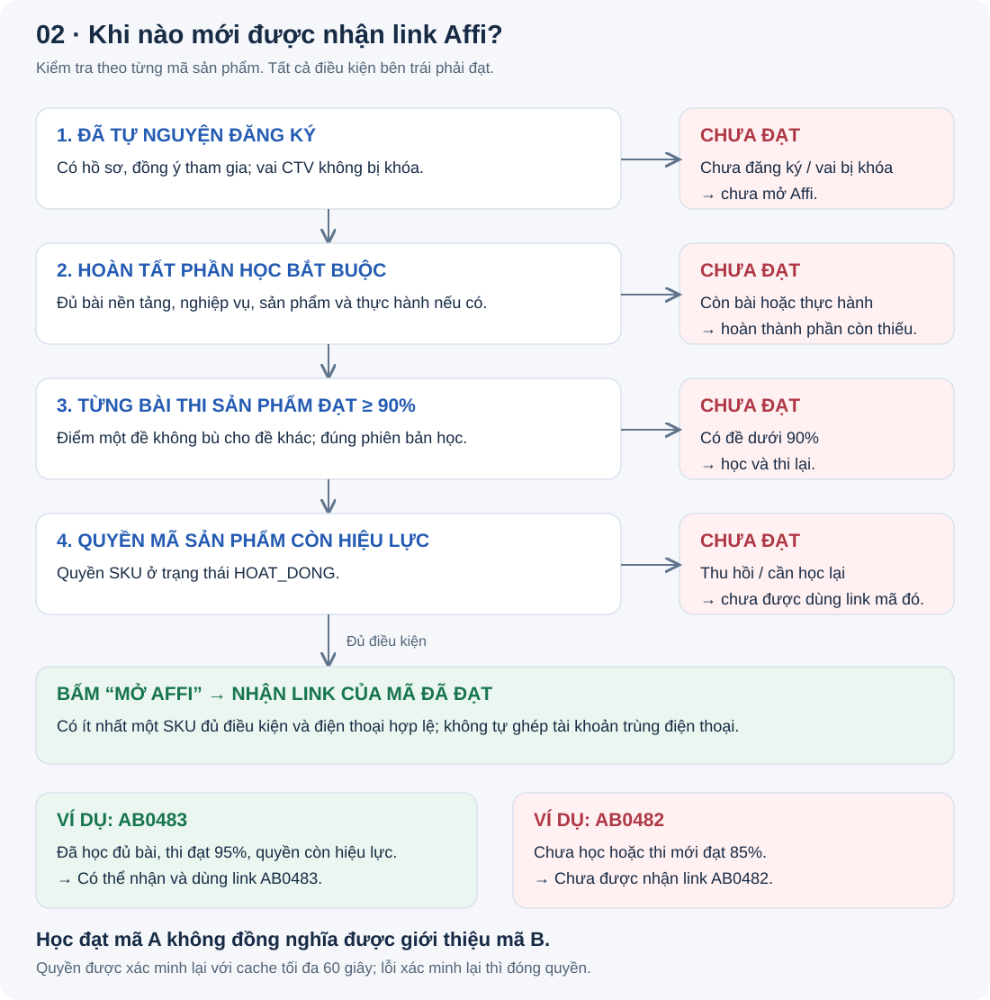
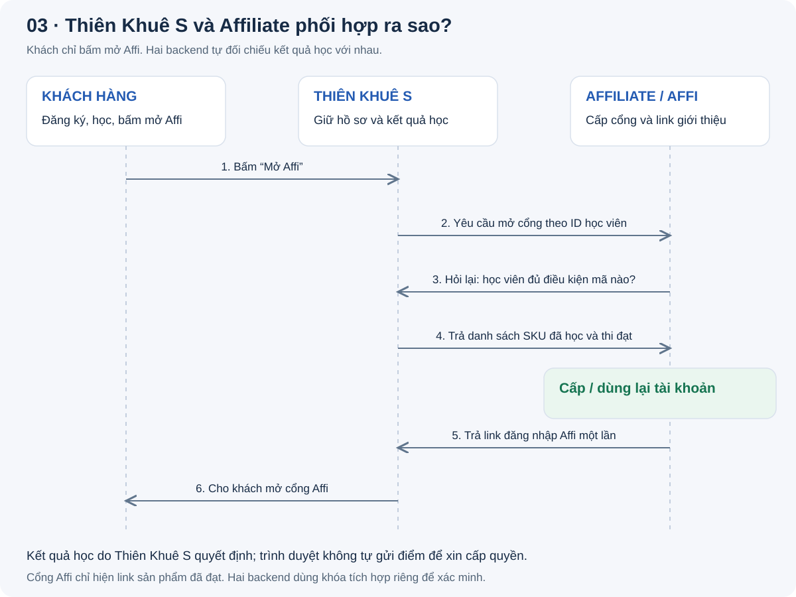

# LYNO Friends: từ khách mua hàng đến người giới thiệu

Cập nhật **17/11/2026** · Luồng đã triển khai trong **Thiên Khuê S + Affiliate**.

**Khách mua hàng → nhận lời mời Zalo → tự đăng ký học → học và thi đạt từ 90% → mở Affi → lấy link đúng mã đã đạt.**

Trong tài liệu này, **SKU** nghĩa là **mã sản phẩm**, ví dụ `AB0483`. **Affi** là cổng để khách lấy link giới thiệu và theo dõi chương trình LYNO Friends.

> Xem bằng Markdown Preview trong VS Code: **Ctrl + Shift + V**. Các sơ đồ là ảnh SVG có sẵn trong repo, không cần cài thêm tiện ích Mermaid. Có thể mở từng ảnh để phóng to.

## 1. Đọc luồng qua sơ đồ

### 1.1. Hành trình của khách hàng



**Cách đọc:** đi theo mũi tên từ bước 1 → 2 → 3 → 4. Sau khi nhận lời mời, khách được tự quyết định có tham gia hay không.

| Thời điểm | Khách có gì? |
| --- | --- |
| Vừa nhận lời mời Zalo | Link đăng ký học |
| Đăng ký học thành công | Tài khoản học và tiến độ học |
| Đủ điều kiện và bấm mở Affi | Cổng Affi, link của những mã sản phẩm đã đạt |

**Lưu ý vận hành:** hiện tại lời mời được soạn khi đơn Affiliate đang theo dõi được CRM xác nhận giao thành công và có hội thoại Zalo phù hợp. Nhân viên vẫn cần duyệt trước khi gửi tin.

### 1.2. Cửa kiểm tra trước khi nhận link



**Ví dụ:** chị Hà đã học đủ và thi mã `AB0483` được **95%** thì có thể nhận link `AB0483`. Nếu mã `AB0482` mới thi được **85%**, chị vẫn phải học và thi lại mã đó.

Hệ thống kiểm tra từng bài thi bắt buộc, phần học nền tảng và thực hành nếu khóa học có yêu cầu. Mã đang bị thu hồi hoặc yêu cầu học lại chưa được tiếp tục dùng link giới thiệu.

### 1.3. Ai xử lý việc gì khi khách bấm mở Affi?



**Cách đọc:** đọc từ trên xuống. Mỗi cột là một bên; mũi tên cho biết bên nào gửi yêu cầu hoặc trả kết quả.

| Bên tham gia | Trách nhiệm |
| --- | --- |
| Khách hàng | Tự nguyện đăng ký, học, thi và bấm mở Affi |
| Thiên Khuê S | Lưu hồ sơ, tiến độ và kết quả học; xác định các mã đủ điều kiện |
| Affiliate | Hỏi lại Thiên Khuê S, cấp hoặc dùng lại tài khoản, hiện link đúng mã |
| CSKH / nhân viên | Duyệt lời mời Zalo, hỗ trợ khi tài khoản hoặc thông tin liên hệ cần xác minh |

Cổng Affi hiện đăng nhập bằng **link một lần có hạn 24 giờ**, sau đó lưu phiên tối đa 30 ngày. Khách tự đặt mật khẩu cho tài khoản học; hệ thống chưa tự gửi một bộ mật khẩu Affi riêng qua Zalo.

## Phụ lục cho lập trình viên và tester

Phần dưới giữ đầy đủ cấu hình local, API, bản đồ source, dữ liệu và cách kiểm thử. Bấm dòng bên dưới để mở khi cần.

<details>
<summary><strong>Mở tài liệu kỹ thuật chi tiết</strong></summary>

## 2. Chạy local và cấu hình

- Thiên Khuê S: `http://localhost:3300/lyno-friends`; API `3310`.
- Affiliate quản trị: `5173`; API `8787`; cổng khách `8790`.
- Supabase local CRM: Auth `54321`, Postgres `54322`, hộp thư thử `http://127.0.0.1:54324`.
- Auth Redirect URLs phải có **đúng** `http://localhost:3300/lyno-friends`; production thêm URL công khai tương ứng. Giữ `enable_signup=false`.
- Không đặt khoá tích hợp trong biến `NEXT_PUBLIC_*`, URL hoặc mã nguồn.

Biến môi trường của **hai backend**: `LYNO_FRIENDS_INTEGRATION_KEY` giống nhau, ít nhất 32 ký tự.

Affiliate `.env`: `THIEN_KHUE_API_URL`, `THIEN_KHUE_WEB_URL`; `FRIENDS_BIZ_ID` nếu máy có nhiều doanh nghiệp (phải chọn đúng LYNO).

Thiên Khuê `apps/api/.env.local`: `AFFILIATE_API_URL`, `AFFILIATE_PORTAL_URL` (phải trùng Địa chỉ cổng trong cấu hình LYNO Friends), `THIEN_KHUE_WEB_URL`.

Production cần cấu hình SMTP trong Supabase để thư tới khách thật; ZL-CRM phải kết nối live và có hội thoại Zalo trực tiếp của khách. Hiện giữ quy trình duyệt tin của hệ thống: lời mời tự được soạn sau giao thành công, chỉ gửi khi nhân viên duyệt. Không tự gửi tin thật trong quá trình triển khai/kiểm thử.

### Khởi động

Mở hai terminal, lần lượt ở gốc mỗi repo:

```powershell
# Terminal 1: repo Thien-Khue-System
pnpm.cmd dev

# Terminal 2: repo Affiliate
pnpm.cmd dev
```

Supabase local của CRM phải chạy trước backend Thiên Khuê. Nếu bộ Supabase local đã được thiết lập trên máy, chạy tại thư mục `local-integration` của CRM:

```powershell
npx.cmd --yes supabase@2.118.0 start --workdir .
```

Lệnh trên khởi động stack có sẵn; không thay thế bước chuẩn bị schema và dữ liệu học trên máy mới. Không dùng lệnh reset/seed để sửa lỗi kết nối trên dữ liệu đang sử dụng.

| Nơi cấu hình | Biến | Giá trị local / yêu cầu |
| --- | --- | --- |
| Cả hai backend | `LYNO_FRIENDS_INTEGRATION_KEY` | Cùng một chuỗi ngẫu nhiên, ít nhất 32 ký tự |
| Affiliate `.env` | `THIEN_KHUE_API_URL` | `http://127.0.0.1:3310` |
| Affiliate `.env` | `THIEN_KHUE_WEB_URL` | `http://localhost:3300` |
| Affiliate `.env` | `FRIENDS_BIZ_ID` | ID doanh nghiệp LYNO nếu cần chọn rõ; bỏ trống dùng doanh nghiệp mặc định |
| Thiên Khuê `apps/api/.env.local` | `AFFILIATE_API_URL` | `http://127.0.0.1:8787` |
| Thiên Khuê `apps/api/.env.local` | `AFFILIATE_PORTAL_URL` | `http://localhost:8790` |
| Thiên Khuê `apps/api/.env.local` | `THIEN_KHUE_WEB_URL` | `http://localhost:3300` |

Các URL trong bảng là địa chỉ local mẫu. Khi đưa lên môi trường khác, thay bằng địa chỉ mà backend hoặc khách thực sự truy cập được; cập nhật đồng thời `portalUrl` trong cấu hình LYNO Friends và danh sách Auth Redirect URLs. Khởi động lại backend sau khi đổi biến môi trường.

Kiểm tra nhanh:

```powershell
Invoke-WebRequest http://localhost:3310/api/health -UseBasicParsing
Invoke-WebRequest http://localhost:8790/health -UseBasicParsing
```

## 3. Hợp đồng tích hợp

- `POST /api/lyno-friends/tai-khoan`: công khai, họ tên/email/đồng ý; giới hạn 5 lần/IP/giờ và 1 lần/email/giờ. Gửi email xác nhận, không tiết lộ email đã tồn tại.
- `POST /api/lyno-friends/dang-ky`: Bearer học viên, `{ dong_y: true }`.
- `GET /api/lyno-friends/dieu-kien`: Bearer học viên, kết quả của chính mình.
- `POST /api/lyno-friends/mo-affi`: Bearer học viên, trả link đăng nhập Affi dùng một lần. Không chuyển access token sang Affi.
- `GET /api/lyno-friends/nguoi-hoc/:id`: server Affi lấy kết quả đáng tin, header `x-lyno-friends-key`.
- `GET /api/lyno-friends/don/:id`: cùng header; chỉ đọc các dòng đơn thật từ CRM để kiểm quyền từng SKU.
- `POST /hooks/lyno-friends/provision`: server Thiên Khuê gọi Affi, cùng header, chỉ nhận `{ subject }`; Affi tự đọc lại kết quả học.
- `POST /v1/referral/learning-invitation`: API quản trị soạn lời mời học.

SQLite thêm bảng `referral_training` theo cơ chế schema mở rộng hiện có. Không sửa schema CRM, không reset hay seed dữ liệu thật. Bài test referral cũ bật rõ chế độ chính sách trước đây (`trainingRequired: false`) để tiếp tục kiểm sổ hoa hồng cũ; mặc định vận hành mới là `true`.

### Ví dụ request và response

Các ID dưới đây là ví dụ. Không gửi `subject`, điểm thi hay danh sách sản phẩm từ trình duyệt để tự cấp quyền.

**Tạo yêu cầu tài khoản học** — endpoint công khai bên Thiên Khuê:

```http
POST /api/lyno-friends/tai-khoan
Content-Type: application/json

{"email":"hocvien@example.com","ho_ten":"Nguyễn Hà","dong_y":true}
```

**Đăng ký tham gia** — gửi Bearer token của học viên đã đăng nhập:

```http
POST /api/lyno-friends/dang-ky
Authorization: Bearer <access_token>
Content-Type: application/json

{"dong_y":true}
```

**Kết quả điều kiện** — API Thiên Khuê bọc kết quả trong `data`:

```json
{
  "data": {
    "subject": "11111111-1111-4111-8111-111111111111",
    "name": "Nguyễn Hà",
    "phone": "<số điện thoại trong hồ sơ>",
    "enrolled": true,
    "ready": true,
    "products": [
      {
        "code": "AB0483",
        "courseId": "22222222-2222-4222-8222-222222222222",
        "score": 90,
        "version": 1
      }
    ],
    "courses": []
  }
}
```

`courses` trong ví dụ được rút gọn; response thực tế chứa tên khóa, mã sản phẩm, loại khóa, tiến độ, điểm cao nhất và trạng thái hoàn tất. `score` trong `products` là thông tin tóm tắt; điều kiện cấp quyền được kiểm trên **từng đề bắt buộc**, không dùng điểm của một đề để bù cho đề khác.

**Cấp Affi giữa hai server**:

```http
POST /hooks/lyno-friends/provision
x-lyno-friends-key: <khóa dùng chung của hai backend>
Content-Type: application/json

{"subject":"11111111-1111-4111-8111-111111111111"}
```

Affiliate tự gọi lại `/api/lyno-friends/nguoi-hoc/:id` trước khi cấp tài khoản. Response thành công của hook Affiliate có `url` ở cấp ngoài cùng. Endpoint `/api/lyno-friends/mo-affi` bên Thiên Khuê trả cho giao diện dạng `{ "data": { "url": "..." } }` và kiểm origin đích theo `AFFILIATE_PORTAL_URL`.

## 4. Điều kiện cấp quyền trong source

Thiên Khuê tính danh sách SKU đủ điều kiện trong `LynoFriendsService.dieuKien()`:

1. Có hồ sơ và bản ghi đồng ý tham gia `DANG_KY_LYNO_FRIENDS`.
2. Có vai CTV ở `DANG_HOC` hoặc `HOAT_DONG`; vai `TAM_DUNG`/`KET_THUC` không đủ điều kiện.
3. Hoàn tất các khóa nền tảng/nghiệp vụ bắt buộc áp dụng cho CTV hoặc áp dụng chung, nếu có.
4. Khóa sản phẩm đang bật, có `mau_id` và `ma_mau`, đã hoàn tất bài học và điều kiện thực hành nếu khóa yêu cầu.
5. Đạt từng bài kiểm tra bắt buộc từ 90%, với lần làm được hệ thống đào tạo công nhận theo phiên bản tài liệu.
6. Quyền SKU tương ứng đang `HOAT_DONG`; `CAN_HOC_LAI` và `THU_HOI` bị chặn.

`ready=true` khi danh sách SKU đủ điều kiện không rỗng. Lúc mở Affi, hồ sơ còn phải có số điện thoại hợp lệ để tạo người giới thiệu. Đã có liên kết `(doanh nghiệp, học viên)` thì dùng lại tài khoản; trùng điện thoại với tài khoản khác thì báo CSKH xác minh, không tự ghép tài khoản.

Affiliate lưu cache quyền tối đa 60 giây và chủ động làm mới khi còn không quá 10 giây. Nếu lần xác minh lại lỗi, cache bị đánh hết hạn. Quyền thu hồi có thể còn hiệu lực trong khoảng cache còn hạn; hệ thống hiện không đẩy sự kiện thu hồi tức thời từ Thiên Khuê sang Affiliate.

## 5. Bản đồ mã nguồn

Đường dẫn trong các bảng tính từ gốc **repo tương ứng**.

### Repo Thien-Khue-System

| File | Vai trò |
| --- | --- |
| `apps/web/src/app/(storefront)/lyno-friends/page.tsx` | Route công khai `/lyno-friends` |
| `apps/web/src/features/lyno-friends/trang-friends.tsx` | Form xác nhận email, đặt mật khẩu, đăng ký học, xem khóa và mở Affi |
| `apps/api/src/controllers/lyno-friends.controller.ts` | Endpoint, DTO, danh tính từ Bearer token và header tích hợp |
| `apps/api/src/services/lyno-friends.service.ts` | Tính điều kiện học, giới hạn yêu cầu email, gọi cấp Affi |
| `apps/api/src/repositories/lyno-friends.repository.ts` | Lưu đồng ý, thêm vai CTV học viên, đọc dữ liệu đào tạo |
| `apps/api/src/infrastructure/supabase/supabase-admin.service.ts` | `moiHocVienFriends()` gửi thư mời xác nhận qua Supabase Auth admin |
| `apps/api/src/services/dao-tao.service.ts` | Luồng học/thi, xét đạt và cấp quyền SKU có sẵn |
| `apps/api/src/modules/lyno-friends.module.ts` | Đăng ký controller, service và repository |
| `apps/web/src/components/khung/nav.ts` | Mục menu LYNO Friends / Affi |

### Repo Affiliate

| File | Vai trò |
| --- | --- |
| `packages/orchestrator/src/crm/lyno-crm.ts` | Sau đồng bộ đơn giao thành công, gọi xếp lời mời học |
| `packages/orchestrator/src/crm/friends-learning-invite.ts` | Soạn lời mời, chống trùng theo đơn, gửi Zalo sau duyệt |
| `packages/orchestrator/src/core/approvals.ts` | Xử lý duyệt/sửa/từ chối `friends_learning_invite` |
| `apps/web/src/pages/Approvals.tsx` | Hiển thị nội dung lời mời để nhân viên duyệt |
| `apps/web/src/pages/Friends.tsx` | CSKH soạn lời mời học thay cho cấp mã ngay |
| `packages/referral/src/training.ts` | Đọc kết quả từ Thiên Khuê, cache quyền và cấp tài khoản Affi |
| `packages/referral/src/index.ts` | Kiểm mã, tạo link, giới hạn sản phẩm được chia sẻ và đăng nhập cổng |
| `packages/referral/src/crm-sync.ts` | Đọc các dòng đơn thật để kiểm SKU khi đồng bộ đơn giới thiệu mới |
| `apps/api/src/routes/referral.ts` | Hook cấp Affi, soạn lời mời và API quản trị referral |
| `apps/web/src/components/Referral.tsx` | Kiểm mã trên phiếu đơn; gửi `approvalId` để server xác định sản phẩm |
| `apps/api/src/routes/orders.ts` | Làm mới quyền khi đẩy lại đơn có mã giới thiệu |
| `apps/friends/src/app.ts` | Cổng khách `/p`, link `/f/:code/:product`, lọc link theo quyền |
| `packages/db/src/schema.ts` | Schema SQLite, gồm bảng `referral_training` |

## 6. Dữ liệu và phân chia trách nhiệm

| Nơi lưu | Dữ liệu | Mục đích |
| --- | --- | --- |
| CRM / Supabase Auth | Sản phẩm, đơn hàng, tài khoản xác thực | Nguồn nghiệp vụ mua hàng và đăng nhập |
| Schema `thien_khue` | Hồ sơ, vai, bài học, lần thi, quyền SKU | Nguồn kết quả đào tạo |
| `thien_khue.nhat_ky` | `DANG_KY_LYNO_FRIENDS`, đồng ý, phiên bản điều khoản nội bộ, ngưỡng 90 | Bằng chứng đăng ký tham gia |
| Affiliate SQLite `referrer` | Người giới thiệu, mã, trạng thái | Tài khoản chương trình Affi |
| Affiliate SQLite `referral_training` | `biz_id`, `referrer_id`, `subject`, `products`, `valid_until` | Liên kết học viên và cache SKU đủ điều kiện |
| Affiliate SQLite `approval` | `subject_type=friends_learning_invite`, đơn và nội dung tin | Chờ nhân viên duyệt gửi |
| Affiliate SQLite `bot_send_key` | Khóa gửi theo doanh nghiệp và đơn | Chống gửi lại khi đã gửi hoặc chưa rõ kết quả |
| Affiliate SQLite `referral_session` | Băm token đăng nhập, phiên và hạn dùng | Đăng nhập cổng khách |

`referral_training` có ràng buộc duy nhất `(biz_id, subject)` và `(biz_id, referrer_id)`. `products` là chuỗi JSON chứa mã, khóa học, điểm tóm tắt và phiên bản tài liệu. Bảng này không thay thế bằng chứng học/thi bên Thiên Khuê.

## 7. Phạm vi tự động và giới hạn hiện tại

| Tình huống | Hành vi hiện tại |
| --- | --- |
| Đơn Affiliate đang theo dõi được CRM cập nhật giao thành công, có hội thoại Zalo trực tiếp | Tự soạn lời mời vào hàng duyệt; nhân viên duyệt mới gửi |
| Đơn không gắn hội thoại Zalo, hội thoại nhóm hoặc khách đã từ chối nhận tin | Không tự xếp lời mời qua luồng này; CSKH kiểm tra kênh liên hệ |
| Đơn huỷ/hoàn hoặc còn yêu cầu đổi trả khi gửi | Chặn gửi lời mời |
| Gửi thất bại và xác định chắc chưa gửi | Cho phép thử lại |
| Gửi bị timeout, chưa rõ phía Zalo đã nhận hay chưa | Giữ khóa chống trùng, cần kiểm tra trên ZL-CRM trước khi xử lý tiếp |
| Khách thi đạt nhưng chưa bấm mở Affi | Chưa tự gửi tài khoản qua Zalo; khách mở từ nút trên trang học |
| Có quyền SKU nhưng chưa có sản phẩm/link bán tương ứng trong danh mục DNA Affiliate | Có thể chưa thấy link sản phẩm; cần kiểm tra mã SKU và URL danh mục |
| Mã/tài khoản cũ chưa liên kết hồ sơ đào tạo | Không được tự miễn điều kiện học trong chế độ `trainingRequired=true` |

Trang `/lyno-friends` là trang công khai. Tham số `?ma=...` chỉ giúp ưu tiên khóa muốn học, **không phải bằng chứng mua hàng hoặc chứng nhận đã thi đạt**. Luồng đăng ký hiện không bắt buộc đối chiếu một đơn mua cụ thể trước khi cho học. Phần tự soạn Zalo không phải bộ quét toàn bộ đơn của CRM; nó được gọi từ luồng đồng bộ các đơn Affiliate đang theo dõi.

Giới hạn gửi yêu cầu email được lưu trong bộ nhớ tiến trình: 5 lần/IP/giờ và 1 lần/email/giờ. Khởi động lại backend sẽ mất bộ đếm; chưa có cơ chế giới hạn dùng chung cho nhiều instance.

## 8. Kiểm thử và nghiệm thu

### Chạy test

Tại repo Affiliate:

```powershell
pnpm.cmd exec vitest run apps/api/tests/referral --maxWorkers=1
pnpm.cmd typecheck
pnpm.cmd build:web
```

Tại repo Thien-Khue-System:

```powershell
pnpm.cmd --filter api test --runInBand test/lyno-friends/eligibility.spec.ts
pnpm.cmd --filter api typecheck
pnpm.cmd --filter web typecheck
```

| File test | Phạm vi |
| --- | --- |
| Affiliate `apps/api/tests/referral/lyno-friends-training.test.ts` | Chặn cấp sớm, ngưỡng 90%, liên kết tài khoản, SKU chưa học, cache/thu hồi, kiểm SKU từ đơn nháp |
| Affiliate `apps/api/tests/referral/lyno-friends-learning-invite.test.ts` | Chỉ soạn sau giao thành công, không cấp tài khoản trong lời mời, chống trùng, chặn đơn huỷ |
| Affiliate các test referral còn lại | Hồi quy mã, đơn, sổ hoa hồng, đồng bộ CRM và đối soát theo chính sách cũ được cấu hình rõ trong fixture |
| Thiên Khuê `apps/api/test/lyno-friends/eligibility.spec.ts` | Đồng ý tham gia, học đủ bài, từng đề đạt 90%, vai bị khóa, thu hồi/học lại, khóa tích hợp |

### Checklist kiểm thử tay

1. Mở `/lyno-friends?ma=AB0483`, dùng một email thử mới và xác nhận muốn tạo tài khoản học.
2. Local: tìm thư tại `http://127.0.0.1:54324`, bấm xác nhận; kiểm tra quay về đúng `/lyno-friends`.
3. Đặt mật khẩu, bổ sung điện thoại, xác nhận tự nguyện tham gia. Chưa học thì nút mở Affi phải bị khóa.
4. Học và làm kiểm tra. Điểm 89% chưa được cấp quyền; đủ bài và đạt từ 90% mới đủ điều kiện cho SKU tương ứng.
5. Bấm **Mở Affi và nhận link sản phẩm**. Tài khoản được dùng lại khi bấm lần sau; chỉ có link SKU đã đạt.
6. Thử mã chưa học hoặc đơn có thêm SKU chưa được phép: server phải từ chối áp mã.
7. Đổi quyền sang học lại/thu hồi, chờ quá thời hạn cache hoặc làm mới: không tiếp tục tạo lượt giới thiệu hợp lệ cho SKU đó.
8. Với đơn Zalo đã giao, kiểm tra mục duyệt **Mời học LYNO Friends**. Chỉ kiểm tra gửi thật bằng tài khoản/kênh thử được phép; không gửi tới khách thật để nghiệm thu local.

## 9. Xử lý lỗi thường gặp

| Dấu hiệu | Kiểm tra |
| --- | --- |
| API Thiên Khuê không lên, báo không tới `54322` | Docker/Supabase local và `DATABASE_URL`; không reset DB để xử lý lỗi kết nối |
| Không nhận được thư xác nhận | Local xem Mailpit; môi trường thật kiểm tra SMTP Supabase; email đã có tài khoản thì đăng nhập |
| Bấm xác nhận bị chuyển sang cổng/trang khác | Auth Redirect URLs và `THIEN_KHUE_WEB_URL` phải khớp chính xác |
| HTTP 429 khi yêu cầu tài khoản | Đã chạm giới hạn IP/email; kiểm tra thư đã nhận và chờ hết thời hạn |
| Đã thi nhưng `ready=false` | Đồng ý tham gia, trạng thái CTV, các khóa nền tảng bắt buộc, tiến độ bài, từng đề, thực hành, phiên bản và quyền SKU |
| `TRAINING_UNCONFIGURED` / `TRAINING_UNAVAILABLE` | Khóa tích hợp, URL backend, tình trạng API Thiên Khuê; không tắt điều kiện học để bỏ qua lỗi |
| `PHONE_REQUIRED` / `PHONE_LINKED` | Bổ sung điện thoại hợp lệ; nếu đã liên kết tài khoản khác thì CSKH xác minh |
| Địa chỉ cổng Affi chưa khớp cấu hình | So sánh `AFFILIATE_PORTAL_URL` bên Thiên Khuê với `portalUrl` bên Affiliate |
| Chưa có link dù mở được Affi | SKU trong kết quả đào tạo phải khớp danh mục DNA và sản phẩm phải có URL bán hợp lệ |
| `ZALO_UNAVAILABLE` | Kết nối ZL-CRM live, nick Zalo, thread trực tiếp và trạng thái thông tin xác thực |
| `ALREADY_SENT` | Kiểm tra khóa gửi và tin trên ZL-CRM; không xóa khóa để gửi lại khi chưa rõ kết quả lần trước |

</details>

---

Nguồn sơ đồ: `scripts/render-lyno-friends-docs.py` trong repo Affiliate. Chạy `python scripts/render-lyno-friends-docs.py` để tạo lại ba ảnh SVG khi sửa luồng.
